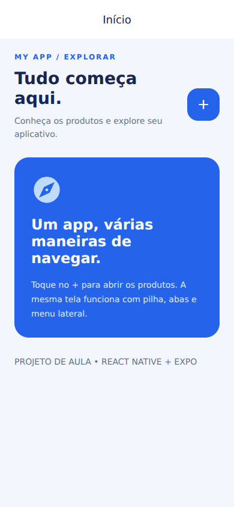
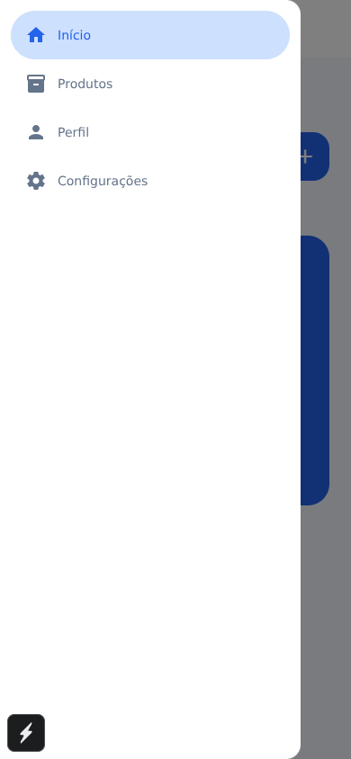
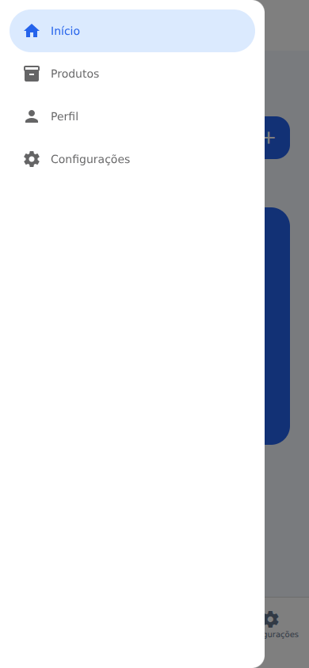

# My App — Navegação React Native

**Aluno:** Gabriel Pinheiro Rodrigues da Silva

Aplicativo de estudo com quatro telas e três tipos de navegação: **Stack**, que empilha Home → Product; **Bottom Tabs**, com quatro abas; e **Drawer**, com menu lateral. Inclui o desafio de navegadores aninhados. Os produtos e preços são exemplos locais, sem API ou compras.

## Como rodar

Requisitos: Node.js 20.19+ (ou 22 LTS), npm e um emulador ou dispositivo com uma versão do Expo Go compatível com **Expo SDK 54**. Para SDKs diferentes, atualize o conjunto de dependências pelo guia oficial do Expo antes de instalar versões nativas isoladamente.

```sh
cd my-app
npm install
npx expo start
```

Leia o QR Code com o Expo Go compatível, pressione `a` para Android ou `i` para simulador iOS (macOS). Para testar no navegador: `npx expo start --web`. O gesto de borda e o botão voltar físico devem ser conferidos no Android/iOS.

Se houver cache antigo: `npx expo start --clear`.

## Trocar a navegação

Em `src/routes/index.jsx`, altere apenas esta linha e salve:

```jsx
const TIPO_DE_NAVEGACAO = 'stack';
```

Valores: `'stack'`, `'bottom'`, `'drawer'` e `'aninhado'`. Se o Fast Refresh conservar estado antigo, recarregue pelo terminal com `r`.

- **stack:** toque no +; Produtos abre com animação. Volte pela seta do cabeçalho ou pelo botão voltar do Android.
- **bottom:** quatro abas em português. Produtos tem badge vermelho 3. Perfil alterna `person-outline`/`person` quando recebe foco.
- **drawer:** abra pelo ☰ ou arraste da borda esquerda no celular. Toque fora para fechar. O item ativo fica destacado.
- **aninhado:** Drawer → Bottom Tabs → Stack na aba Início. O + empilha Produtos dentro de Início. A aba Produtos é uma rota independente. Os itens do Drawer usam `navigation.navigate('tabs', { screen: 'product' })` (e os nomes equivalentes) para chegar a outra aba. O cabeçalho externo some no detalhe para evitar duplicação.

As telas não consultam o tipo de navegador. Home sempre chama `navigation.navigate('product')`.

## Organização

`src/App.jsx`: GestureHandlerRootView, SafeAreaProvider e status bar.

`src/components`: Header, Title, ButtonIcon e Page reutilizáveis.

`src/screens`: Home, Product, Profile e Settings.

`src/routes`: um NavigationContainer, navegadores criados fora dos componentes e opções visuais compartilhadas.

## Prints

As capturas abaixo são da versão web do próprio aplicativo. Confira também os gestos nativos no celular antes da entrega.

### Stack



### Bottom Tabs


### Drawer


### Desafio aninhado


